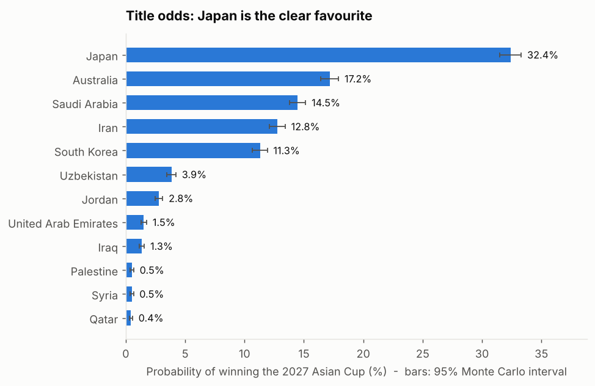

# Machine Learning-Driven Probabilistic Forecasting and Monte Carlo Simulation of the 2027 AFC Asian Cup

> CSCI-630.01 · Omar Elouny · **Status: complete**

## Overview

This project predicts international match outcomes from 150 years of results (1872–2026), then uses the best-calibrated model to run a **10,000-run Monte Carlo simulation** of the **2027 AFC Asian Cup in Saudi Arabia**: six groups of four, the four best third-placed teams, the official tiebreakers and bracket, extra time and penalties.

## Results (10,000 simulated tournaments)

| Team | Group | Elo | Reach R16 | Reach SF | Reach final | **Champion** |
|---|---|---:|---:|---:|---:|---:|
| Japan | F | 1975 | 99% | 65% | 46% | **32.4%** |
| Australia | D | 1898 | 99% | 57% | 30% | **17.2%** |
| Saudi Arabia | A | 1739 | 98% | 54% | 30% | **14.5%** |
| Iran | C | 1865 | 98% | 45% | 26% | **12.8%** |
| South Korea | E | 1845 | 98% | 40% | 24% | **11.3%** |
| Uzbekistan | B | 1750 | 93% | 25% | 11% | **3.9%** |
| Jordan | B | 1714 | 90% | 21% | 8% | **2.8%** |
| United Arab Emirates | E | 1680 | 91% | 15% | 5% | **1.5%** |

Japan is the clear favourite, and five teams hold about 88% of the title probability. Full tables, group-by-group results, sensitivity checks and figures are in [`REPORT.md`](REPORT.md).



## Pipeline

```
results.csv ─► Elo ratings ─► features ─► train and compare 4 models ─► XGBoost match engine
                                                                              │
 10,000 tournaments ◄─ extra time + penalties ◄─ Poisson scores ◄────────────┘
 (groups, tiebreakers, best thirds, bracket)
```

1. **Elo and features.** Elo with tournament weights and goal-margin multipliers (home bonus +100), plus rolling form, rest days and host flags, all computed before each match.
2. **Model selection.** Chronological split (train ≤ 2019, validation 2020–22, test 2023+). XGBoost had the best validation log loss and calibration and was selected.
3. **Score layer.** Poisson goal rates are fitted per pairing so scorelines match XGBoost's win/draw/loss probabilities, which makes goal-difference tiebreakers simulable.
4. **Format.** AFC tiebreakers (head-to-head, goal difference, goals, re-applied to sub-groups, then overall goal difference and goals scored, lots), best-four-thirds table and bracket.
5. **Knockouts.** A tie after 90 minutes goes to simulated extra time, then a shoot-out model fitted on 699 historical shoot-outs.

### Model testing (test set, 2023+, 4,098 matches)

| Model | Log loss | Brier | Accuracy | ECE |
|---|---|---|---|---|
| Class-prior reference | 1.054 | 0.636 | 47.2% | n/a |
| Poisson GLM | 0.880 | 0.517 | 60.2% | 0.033 |
| Logistic Regression | 0.867 | 0.509 | 60.4% | 0.026 |
| **XGBoost** | **0.866** | 0.509 | 60.6% | **0.021** |
| MLP | 0.867 | 0.508 | 60.8% | 0.021 |

The three leading models are statistically close; most of the signal comes from Elo.

## Validation

- **2023 replay:** feeding the real 2023 group results through the format code gave the correct group winners, runners-up, best thirds and **all 8 real Round-of-16 ties**.
- **2023 back-test:** using only pre-tournament data, the model gave the eventual champion Qatar 5.1% (rank 5 of 24). It beat a base-rate guess on stage progression (Brier skill 24%) and placed 14 of the 16 real Round-of-16 teams in its top 16. One tournament is a small sample.
- **Defending champions:** across 307 matches, defending champions scored -0.032 points per game against their Elo expectation (95% interval -0.081 to +0.015), so no champion bonus was added.
- **Other checks:** 51 unit tests; five seeds agree within about 1 point; extra-time assumptions move no title probability by more than 1.4 points.

## Assumptions and limitations

- Ratings are frozen at the last result in the data (6 Oct 2026) and not updated during the tournament.
- Tiebreakers follow the 2023 regulations, which are the same for 2027. The group matchday order is assumed and only affects a rare last-round shoot-out rule.
- Disciplinary points cannot be simulated, so those ties go to lots.
- Saudi Arabia is the true home side in all its matches; this is worth about 9 points of title probability and is the least certain effect.
- Intervals reflect simulation noise only, not uncertainty in the model itself.

## Repository structure

```
├── README.md
├── REPORT.md                           # Full results, figures, sensitivity and validation
├── afc_asian_cup_model_testing.ipynb   # Elo, features, four models, evaluation
├── afc_asian_cup_simulation.ipynb      # Builds the engine, runs 10,000 tournaments, shows figures
├── run_simulation.py                   # Quick end-to-end run (prints the table)
├── make_report.py                      # 10,000 runs + robustness checks + figures + REPORT.md
├── validation.py                       # 2023 replay and back-test, defending-champion check
├── afc_sim/                            # config, data, engine, scores, groupstage, shootouts, knockout, simulate
├── tests/                              # 51 pytest tests
├── results/                            # CSV/JSON outputs
├── figures/                            # PNG charts
└── data/                               # Kaggle CSVs (not included; see below)
```

## Getting started

```bash
git clone https://github.com/Omareltouny/IntroAIMonteCarloAsianCup2027.git
cd IntroAIMonteCarloAsianCup2027
pip install -r requirements.txt
# download the Kaggle dataset into ./data/ (results.csv, former_names.csv, shootouts.csv, goalscorers.csv)
python make_report.py      # about 1 minute: results/, figures/, REPORT.md
python validation.py       # 2023 replay and back-test
python -m pytest tests -q
```

Data: [International Football Results from 1872 to 2026](https://www.kaggle.com/datasets/martj42/international-football-results-from-1872-to-2017) (Mart Jürisoo, Kaggle).
