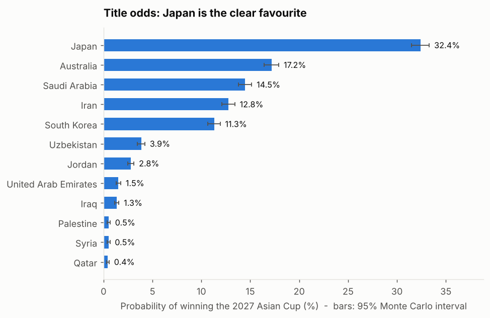
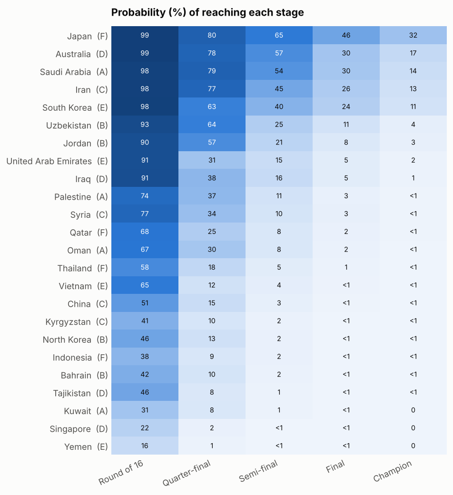
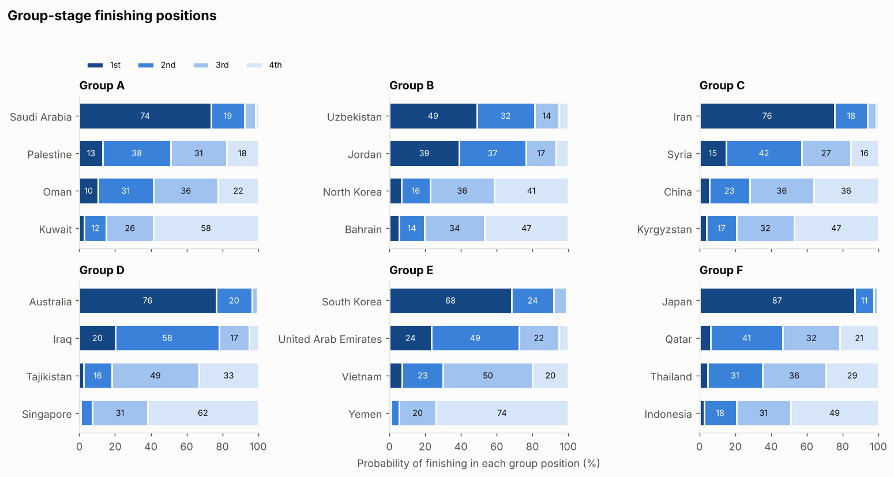
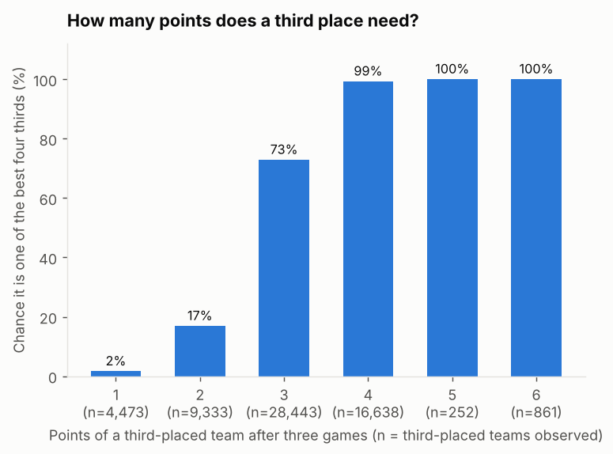
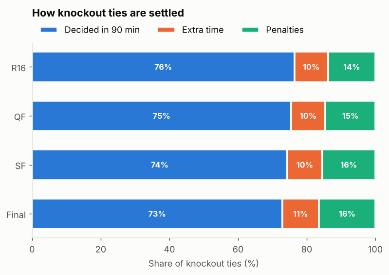
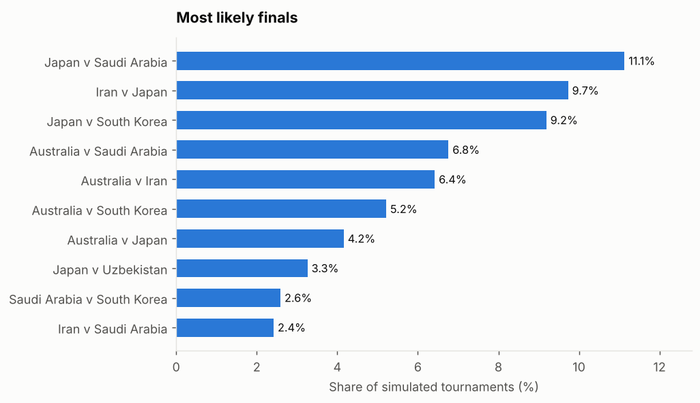
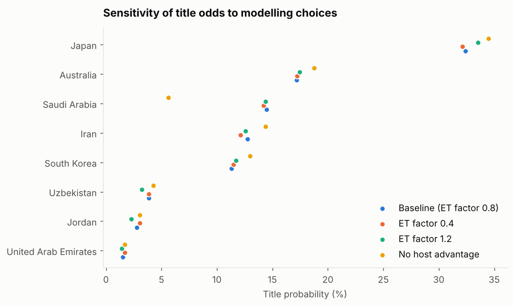
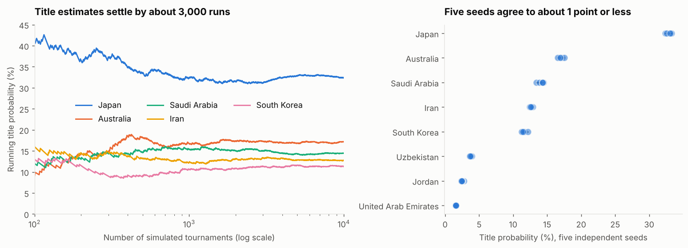
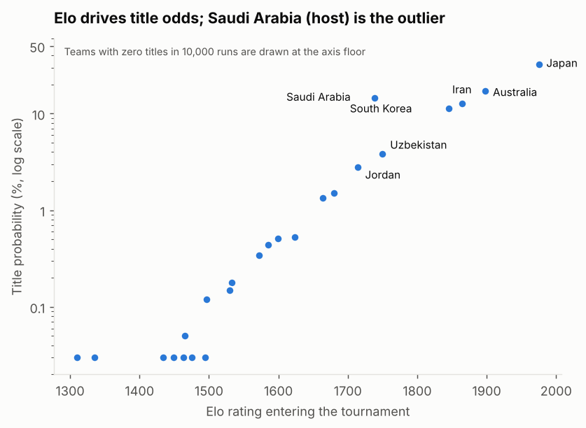
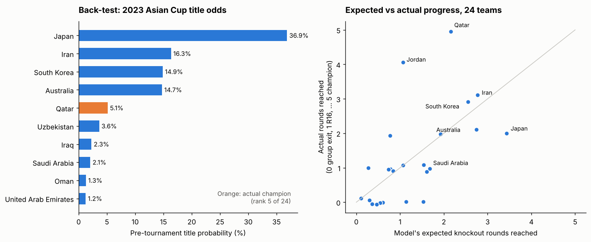

# Forecasting the 2027 AFC Asian Cup: Monte Carlo report

*Omar Elouny · CSCI-630.01 · 10,000 simulated tournaments (seed 2027) · generated by `make_report.py`*

## 1. Summary

I simulated the 24-team 2027 AFC Asian Cup 10,000 times. Each match is drawn from an XGBoost win/draw/loss model (trained on every international result through 6 October 2026), turned into scorelines by a Poisson layer, and played through the official group tiebreakers, the best-four-thirds rule, the published bracket, extra time and penalties.

- **Japan is the favourite at 32.4% (±0.9)**, ahead of Australia (17.2% (±0.7)), Saudi Arabia (14.5% (±0.7)), Iran (12.8% (±0.7)) and South Korea (11.3% (±0.6)). Those five hold 88% of the title probability.
- **The field is top-heavy.** Teams outside the top ten win the tournament in 1.9% of runs.
- **Saudi Arabia's host advantage is worth about +8.8 points of title probability** (14.5% with it, 5.6% if it is treated like a neutral side), mostly because it lifts them out of Group A more reliably (98% vs 94% to reach the Round of 16).
- **About 24% of knockout ties go beyond 90 minutes**, and 14% reach penalties, so a coin-flip-like shoot-out decides roughly one knockout game in 7.
- **Results are numerically stable**: five independent 10,000-run seeds differ by at most 1.0 percentage points for any team's title odds.



## 2. Method in one page

| Stage | What it does |
|---|---|
| Ratings and features | Elo from 49,945 matches (1872-2026) with tournament weights, goal-margin multiplier and host bonus; rolling form, experience, rest, neutral/host flags. Frozen at the last result in the data. |
| Match model | XGBoost (depth 2, 487 trees, tuned on 2020-22 validation; best-calibrated model in the model-testing notebook) refit on all matches through 2026. Neutral-venue probabilities are symmetrised; Saudi Arabia is the true home side in all its games. |
| Score layer | For each pairing, independent-Poisson rates are fitted so the implied W/D/L matches XGBoost (max error < 1e-6), then the score distribution is reweighted so the W/D/L marginals are exactly XGBoost's. Scores feed goal-difference tiebreakers. |
| Groups | Six groups of four; points, then head-to-head points / goal difference / goals, re-applied to subsets, then overall goal difference and goals scored, then a penalty shoot-out (if two teams met in the last round) or lots. |
| Best thirds | Four best of six on points, goal difference, goals scored, then lots; placed in the bracket with the official 15-row table. |
| Knockouts | R16 matches 37-44, QF 45-48, SF 49-50, final 51 (no third-place game). A tie after 90 minutes gets 30 minutes of extra time (Poisson, intensity 0.8 of the regulation rate), then a symmetric shoot-out model using Elo gap and each team's shrunk shoot-out history. |

Full details and assumptions are in the README.

## 3. Who wins the tournament

| Group | Elo | Advance | QF | SF | Final | Champion |
|---|---:|---:|---:|---:|---:|---:|
| Japan | F | 1975 | 99.4 | 80.4 | 65.4 | 46.4 | 32.4 |
| Australia | D | 1898 | 99.3 | 78.0 | 57.4 | 30.1 | 17.2 |
| Saudi Arabia | A | 1739 | 97.8 | 79.4 | 53.9 | 29.7 | 14.5 |
| Iran | C | 1865 | 98.2 | 77.1 | 45.2 | 26.0 | 12.8 |
| South Korea | E | 1845 | 98.5 | 62.7 | 39.7 | 24.0 | 11.3 |
| Uzbekistan | B | 1750 | 92.8 | 63.6 | 24.7 | 11.2 | 3.8 |
| Jordan | B | 1714 | 90.4 | 57.2 | 20.7 | 7.7 | 2.8 |
| United Arab Emirates | E | 1680 | 90.6 | 31.3 | 14.9 | 5.4 | 1.5 |
| Iraq | D | 1664 | 91.0 | 37.9 | 16.2 | 5.3 | 1.3 |
| Palestine | A | 1624 | 74.2 | 36.8 | 11.1 | 2.7 | 0.5 |
| Syria | C | 1599 | 76.7 | 34.1 | 10.5 | 2.9 | 0.5 |
| Qatar | F | 1585 | 67.6 | 25.4 | 8.4 | 2.2 | 0.4 |
| Oman | A | 1572 | 67.2 | 29.6 | 8.3 | 1.9 | 0.3 |
| Thailand | F | 1533 | 58.2 | 18.0 | 5.4 | 1.2 | 0.2 |
| Vietnam | E | 1530 | 65.2 | 12.3 | 4.0 | 1.0 | 0.2 |
| China | C | 1497 | 51.2 | 14.9 | 3.4 | 0.6 | 0.1 |
| Kyrgyzstan | C | 1465 | 40.8 | 9.6 | 1.6 | 0.2 | 0.0 |
| North Korea | B | 1494 | 46.3 | 12.8 | 2.3 | 0.4 | 0.0 |
| Indonesia | F | 1475 | 37.9 | 8.7 | 2.2 | 0.3 | 0.0 |
| Bahrain | B | 1463 | 41.8 | 10.4 | 1.7 | 0.4 | 0.0 |
| Tajikistan | D | 1434 | 45.9 | 8.2 | 1.2 | 0.2 | 0.0 |
| Kuwait | A | 1449 | 30.8 | 8.3 | 1.3 | 0.2 | 0.0 |
| Singapore | D | 1310 | 22.2 | 2.2 | 0.2 | 0.0 | 0.0 |
| Yemen | E | 1335 | 16.1 | 1.2 | 0.2 | 0.0 | 0.0 |

*Percentages. Monte Carlo 95% interval is at most ±1.0 points for any entry (±0.9 for the leader's title odds).*



**Reading the table.** Japan's edge comes from rating: Elo 1975, the highest in the field by 77 points. Saudi Arabia (Elo 1739) reaches the quarter-finals about as often as Iran (Elo 1865) and Australia (79% vs 77% and 78%) despite a much lower rating. That is the host effect: with home advantage switched off its quarter-final chance falls to 66% (section 6). The size of that effect comes from the model's host features, which are learned from matches with a home side, so it is the least certain number in this report.

## 4. Group stage

**Group A** (mean Elo 1596)

| Elo | Win group % | Advance % | Advance as 3rd % |
|---|---:|---:|---:|
| Saudi Arabia | 1739.0 | 73.6 | 97.8 | 5.4 |
| Palestine | 1624.0 | 13.2 | 74.2 | 23.1 |
| Oman | 1572.0 | 10.4 | 67.2 | 25.8 |
| Kuwait | 1449.0 | 2.8 | 30.8 | 15.7 |
**Group B** (mean Elo 1605)

| Elo | Win group % | Advance % | Advance as 3rd % |
|---|---:|---:|---:|
| Uzbekistan | 1750.0 | 48.9 | 92.8 | 11.6 |
| Jordan | 1714.0 | 39.0 | 90.4 | 14.0 |
| North Korea | 1494.0 | 6.7 | 46.3 | 23.5 |
| Bahrain | 1463.0 | 5.4 | 41.8 | 22.1 |
**Group C** (mean Elo 1607)

| Elo | Win group % | Advance % | Advance as 3rd % |
|---|---:|---:|---:|
| Iran | 1865.0 | 75.7 | 98.2 | 4.2 |
| Syria | 1599.0 | 15.0 | 76.7 | 19.6 |
| China | 1497.0 | 5.5 | 51.2 | 23.2 |
| Kyrgyzstan | 1465.0 | 3.9 | 40.8 | 20.0 |
**Group D** (mean Elo 1576)

| Elo | Win group % | Advance % | Advance as 3rd % |
|---|---:|---:|---:|
| Australia | 1898.0 | 76.5 | 99.3 | 2.7 |
| Iraq | 1664.0 | 20.3 | 91.0 | 12.9 |
| Tajikistan | 1434.0 | 2.4 | 45.9 | 27.8 |
| Singapore | 1310.0 | 0.8 | 22.2 | 15.0 |
**Group E** (mean Elo 1598)

| Elo | Win group % | Advance % | Advance as 3rd % |
|---|---:|---:|---:|
| South Korea | 1845.0 | 68.4 | 98.5 | 6.5 |
| United Arab Emirates | 1680.0 | 23.6 | 90.6 | 18.2 |
| Vietnam | 1530.0 | 7.2 | 65.2 | 35.2 |
| Yemen | 1335.0 | 0.8 | 16.1 | 10.5 |
**Group F** (mean Elo 1642)

| Elo | Win group % | Advance % | Advance as 3rd % |
|---|---:|---:|---:|
| Japan | 1975.0 | 86.8 | 99.4 | 1.8 |
| Qatar | 1585.0 | 6.1 | 67.6 | 21.0 |
| Thailand | 1533.0 | 4.5 | 58.2 | 22.9 |
| Indonesia | 1475.0 | 2.6 | 37.9 | 17.3 |



- **Strongest group by mean Elo:** Group F (1642). **Weakest:** Group D (1576).
- **Most open group:** Group B, where the favourite wins the group only 49% of the time.
- Average group-stage match: 2.50 goals, 22% draws (Asian Cups since 2004: 2.68 goals, 21% draws).
- Mean points: winners 7.6, runners-up 5.1, third 3.0, fourth 0.9.

### Best third-placed teams

Four of six third-placed teams advance, so even a modest haul often survives. A third-placed team with 4 points advances 99% of the time, with 3 points 73%, with 2 points 17% and with 6 points 100%.



### Tiebreakers

Tiebreakers matter constantly in a four-team group: across 10,000 tournaments the cascade was needed 3.0 times per tournament. Resolution counts: head-to-head 11,969, overall goal difference / goals scored 16,244, last-round shoot-out 424, drawing of lots 889. Lots includes disciplinary points, which cannot be simulated, so treat it as an upper bound on how often cards would decide a placing.

## 5. Knockout rounds



Across all knockout games, 75.6% are settled in 90 minutes, 9.9% in extra time and 14.4% on penalties. The champion needed a shoot-out to win the final in 16.5% of tournaments.

The shoot-out model (fitted on 699 historical shoot-outs) gives a stronger Elo side only a small edge: on a held-out 2015+ sample its log loss is 0.685 versus 0.693 for a fair coin. The first shooter won 52.4% of 269 recorded shoot-outs, not a significant edge, so it is left out.

**Most likely finals**

- Japan v Saudi Arabia: 11.1%
- Iran v Japan: 9.7%
- Japan v South Korea: 9.2%
- Australia v Saudi Arabia: 6.8%
- Australia v Iran: 6.4%
- Australia v South Korea: 5.2%
- Australia v Japan: 4.2%
- Japan v Uzbekistan: 3.3%

**Most likely Round-of-16 ties**

- Japan v United Arab Emirates: 42.5%
- Iraq v South Korea: 40.4%
- Saudi Arabia v Syria: 21.0%
- Japan v South Korea: 20.5%
- Australia v Vietnam: 19.7%
- Japan v Vietnam: 19.6%
- China v Saudi Arabia: 19.6%
- Palestine v Syria: 19.4%



## 6. Robustness

| Baseline (ET factor 0.8) | ET factor 0.4 | ET factor 1.2 | No host advantage |
|---|---:|---:|---:|
| Japan | 32.4 | 32.1 | 33.5 | 34.5 |
| Australia | 17.2 | 17.2 | 17.5 | 18.8 |
| Saudi Arabia | 14.5 | 14.2 | 14.4 | 5.6 |
| Iran | 12.8 | 12.1 | 12.6 | 14.4 |
| South Korea | 11.3 | 11.5 | 11.7 | 13.0 |
| Uzbekistan | 3.9 | 3.8 | 3.2 | 4.3 |
| Jordan | 2.8 | 3.0 | 2.3 | 3.0 |
| United Arab Emirates | 1.5 | 1.7 | 1.4 | 1.7 |

*Title probability (%). Each column is a separate 10,000-run simulation with the same seed.*



- **Extra-time intensity** (0.4 to 1.2 of the regulation rate) moves no team's title odds by more than 1.4 points.
- **Host advantage** matters mainly for Saudi Arabia, and slightly redistributes title odds to the other favourites without it.
- **Seed stability**: five independent seeds agree within 1.0 points.





## 7. Validation



- **Replay of the real 2023 group stage.** Feeding the actual 2023 results through the format code gave the correct winner and runner-up of all six groups, the correct four best third-placed teams (Jordan, Palestine, Syria, Indonesia) and **8 of 8 real Round-of-16 ties**. This checks the tiebreakers, third-place ranking and bracket table against a real tournament (2023 used the same bracket as 2027).
- **Pre-tournament back-test of the 2023 Asian Cup** (data before kick-off only, 10,000 simulations). Qatar, the champion, was given 5.1% (rank 5 of 24; a uniform guess is 4.2%). Japan was the favourite at 36.9% and lost in the quarter-finals; runner-up Jordan had 0.5%. Over all stages the Brier score was 0.530 against 0.700 for a base-rate guess (a 24% improvement), 14 of the 16 real Round-of-16 teams were in the model's top 16, and group-match log loss was 0.81 against 1.06 for class frequencies (36 matches). One tournament is a small sample: it shows the forecast carries real information, not that the title odds are perfectly calibrated.
- **Defending champions.** Across 307 matches by defending champions in 64 continental tournaments and World Cups since 1996, they scored -0.032 points per game relative to their Elo expectation (95% interval -0.081 to +0.015). There is no evidence of a champion effect beyond rating, so Qatar's low odds (Elo 1585, in the strongest group) reflect its current strength rather than a missing feature.

## 8. Limitations

1. **Ratings are frozen** at 6 October 2026. Form, injuries, squad changes and the three months before kick-off are not captured. Ratings are not updated during the simulated tournament.
2. **Tiebreakers follow the 2023 regulations** because the 2027 wiki page did not list them; the group matchday order is assumed (it only affects the rare last-round shoot-out rule).
3. **Disciplinary points are not modelled**; ties that would reach that rule are decided by lots.
4. **Knockout draws are probably under-modelled.** The model sends 14% of knockout ties to penalties; 16 of about 62 Asian Cup knockout games since 2004 (26%) did. The sample is small, so this is a hint rather than a finding, but knockouts may be cagier than the average match the model was trained on.
5. **Model uncertainty is not propagated.** The Monte Carlo intervals reflect simulation noise only, not uncertainty in the XGBoost probabilities or Elo ratings, so true uncertainty about each team's odds is wider than the intervals shown.
6. **Probabilities are not betting advice**; they are outputs of a simple, transparent model.

## 9. Reproduce

```bash
pip install -r requirements.txt            # put the Kaggle CSVs in data/
python validation.py                       # 2023 replay and back-test, defending-champion check
python make_report.py                      # about 0 min: results/, figures/, REPORT.md
python -m pytest tests -q
```
